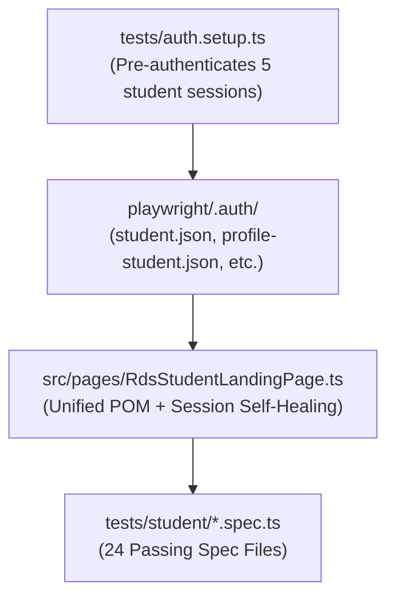

# NSU RDS Playwright Test Automation
> **Autonomous End-to-End Test Suite for North South University (NSU) RDS Portal**  
> **Target Environment:** `http://10.102.11.254/rds/` (Local Intranet Test Server)  
> **Contributors:** Mahin (@mahunn) & Borshon (@Borshan2004)  
> **Current Test Status:** **24/24 Tests Passing (100% Green)**

---

## 📚 Essential Documentation

* 📖 **[System & Test Execution Runbook](docs/SYSTEM_AND_EXECUTION_GUIDE.md)**: Full architecture guide, session management, Windows execution tips, and complete 24-test inventory.
* 🤝 **[Team Collaboration Guide](docs/TEAM_COLLABORATION_GUIDE.md)**: Git branching strategy, dedicated student account matrix, and PR review workflow.
* 🗺️ **[Portal Structure Catalog](docs/PORTAL_STRUCTURE.md)**: 60-route offline DOM catalog with exact input IDs, buttons, and alert texts.

---

## ⚡ Quick Test Commands

### 1. Watch a Test Run in the Browser (Headed Mode)
```powershell
# Advising Window (Headed)
npm.cmd run test:advising:headed

# Change Password (Headed)
npm.cmd run test:password:headed

# Major Declaration (Headed)
npm.cmd run test:major:headed

# Car Parking (Headed)
npx.cmd playwright test tests/student/car-parking.spec.ts --headed
```

### 2. Fast Headless Runs (Individual Modules)
```powershell
npm.cmd run test:advising       # Advising Window & Course Slip
npm.cmd run test:profile        # Student Information (General & Personal)
npm.cmd run test:password       # Change Password & OTP Modal
npm.cmd run test:major          # Major Declaration Prerequisite
npm.cmd run test:parking        # Car Parking Service
npm.cmd run test:exclusion      # Course Exclusion (Senior Student)
npm.cmd run test:inclusion      # Course Inclusion Request
npm.cmd run test:credit-status  # Credit / Non-Credit Status Update
npm.cmd run test:forgot-id      # Forgot RFID Application
npm.cmd run test:unlock-id      # ID Unlock Request
npm.cmd run test:leave          # Application for Leave
npm.cmd run test:drop           # Semester Drop Application
npm.cmd run test:faculty        # Faculty Exam Marks Batch Entry
```

### 3. Run the Entire Suite (All 24 Tests)
```powershell
npx.cmd playwright test
```

### 4. Interactive Debugging & HTML Reports
```powershell
# Interactive Playwright Desktop UI
npx.cmd playwright test --ui

# Open the HTML Test Report
npx.cmd playwright show-report --port 9324
```

### 5. Pull Latest Team Updates
```powershell
npm.cmd run sync
```

---

## 🏗️ Architecture Overview



* **Session Isolation:** NSU RDS allows only one active login per ID. Accounts are separated by module (`2421354` for Profile/Advising; `2512560`, `2231451`, `2421226`, `2425471` for Services).
* **Self-Healing Sessions:** [`RdsStudentLandingPage.goto()`](src/pages/RdsStudentLandingPage.ts) detects expired or superseded sessions and re-authenticates automatically.
* **Strict Locator Hierarchy:** Accessible locators (`getByRole`, `getByLabel`, `getByPlaceholder`) take priority over raw CSS/XPath.
* **Web-First Assertions:** Zero arbitrary sleeps (`waitForTimeout`); only auto-waiting web assertions (`expect(locator).toBeVisible()`).

---

## 🛠️ Setup & Installation

```bash
# 1. Clone the repository
git clone https://github.com/mahunn/RDS-Playwrite-Test.git
cd RDS-Playwrite-Test

# 2. Install dependencies
npm install

# 3. Install Playwright browser binaries
npx playwright install chromium

# 4. Create your local .env from template
cp .env.example .env
```
