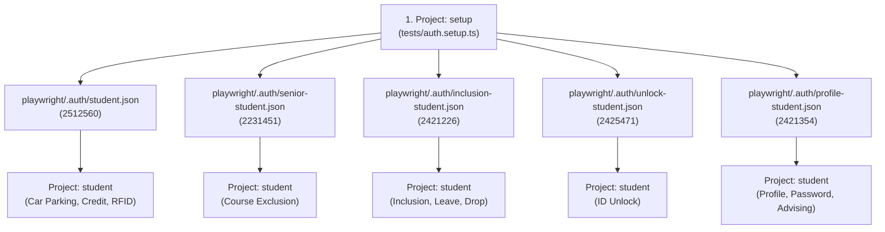

# NSU RDS Automation — System Architecture & Test Execution Guide
> **Repository:** [mahunn/RDS-Playwrite-Test](https://github.com/mahunn/RDS-Playwrite-Test)  
> **Target Environment:** NSU RDS Local Intranet Test Server (`http://10.102.11.254/rds/`)  
> **Framework:** Playwright Test + TypeScript  
> **Status:** 24/24 Tests Passing (Smoke & Regression)

---

## Table of Contents
1. [System Architecture & Portal Quirks](#1-system-architecture--portal-quirks)
2. [Authentication & Session Management](#2-authentication--session-management)
3. [Page Object Model (POM) Architecture](#3-page-object-model-pom-architecture)
4. [How to Run Tests (Command Reference)](#4-how-to-run-tests-command-reference)
5. [Windows PowerShell & Terminal Tips](#5-windows-powershell--terminal-tips)
6. [Complete Test Inventory (24 Automated Tests)](#6-complete-test-inventory-24-automated-tests)
7. [Step-by-Step: Adding a New Test](#7-step-by-step-adding-a-new-test)
8. [Troubleshooting & Common Errors](#8-troubleshooting--common-errors)

---

## 1. System Architecture & Portal Quirks

The **North South University (NSU) RDS Portal** (`http://10.102.11.254/rds/`) is a PHP/Bootstrap university management portal. When automating tests against it, several critical server behaviors must be accounted for:

### A. The Single Active Session Constraint
* **Behavior:** The RDS server enforces **strictly one active PHP session per student ID**.
* **Impact:** If user `2512560` logs in while another test or browser session is active for `2512560`, the server invalidates the previous session cookie immediately.
* **Our Architecture Solution:**
  1. We split student testing across **dedicated student IDs** (`2421354` for Mahin, `2512560`, `2231451`, `2421226`, `2425471` for Borshon).
  2. Sessions are pre-warmed once in `tests/auth.setup.ts` into isolated JSON storage state files under `playwright/.auth/`.
  3. All landing page navigations feature **Session Self-Healing**: if the server redirects to `/rds/` due to a dropped session, `goto()` recovers the login transparently without failing the spec.

### B. Two-Step Authentication (`preLogin`)
* Username is submitted on the first screen.
* The password field is revealed dynamically.
* If a previous session exists on another IP or device, an **"Already logged in" takeover confirmation dialog** appears with a "Yes" button. Both `LoginPage.ts` and `RdsLoginPage.ts` detect and accept this modal automatically.

---

## 2. Authentication & Session Management

The framework uses Playwright's Project Dependencies to authenticate once and reuse sessions across all specs:



### Account Assignment Table:
| Student ID | Owner / Module | Auth Storage File |
|---|---|---|
| `2512560` | Borshon — Car Parking, Credit Status, Forgot ID | `playwright/.auth/student.json` |
| `2231451` | Borshon — Course Exclusion (Senior) | `playwright/.auth/senior-student.json` |
| `2421226` | Borshon — Course Inclusion, Leave, Semester Drop | `playwright/.auth/inclusion-student.json` |
| `2425471` | Borshon — ID Unlock | `playwright/.auth/unlock-student.json` |
| `2421354` | Mahin — Profile, Change Password, Major, Advising | `playwright/.auth/profile-student.json` |
| `sva` | Silvia Ahmed — Faculty Exam Marks Entry | Dynamic session |

---

## 3. Page Object Model (POM) Architecture

All page classes reside in `src/pages/` and extend `BasePage`:

* [`BasePage.ts`](file:///e:/RDS-Playwrite-Test/src/pages/BasePage.ts) — Base class providing `page`, `goto()`, and `waitForReady()`.
* [`RdsStudentLandingPage.ts`](file:///e:/RDS-Playwrite-Test/src/pages/RdsStudentLandingPage.ts) — **Unified Student Dashboard**. Contains navigation for:
  * Profile (Student Info, Change Password, Major Declaration)
  * Advising (Advising Window)
  * Services (Car Parking, Credit Status, Exclusion, Inclusion, Forgot ID, ID Unlock, Leave, Semester Drop)
* [`LandingPage.ts`](file:///e:/RDS-Playwrite-Test/src/pages/LandingPage.ts) — Extends `RdsStudentLandingPage` for seamless backwards compatibility.
* [`RdsLoginPage.ts`](file:///e:/RDS-Playwrite-Test/src/pages/RdsLoginPage.ts) / [`LoginPage.ts`](file:///e:/RDS-Playwrite-Test/src/pages/LoginPage.ts) — Encapsulates login, takeover modal, and faculty/student entry.

---

## 4. How to Run Tests (Command Reference)

You can run tests using either `npm run <script>` or `npx playwright test <path>`.

### A. Quick Feature Runs (Headless)
| Command | Feature Area |
|---|---|
| `npm run test:profile` | Student Information (General & Personal Info) |
| `npm run test:password` | Change Password & Verification Code Modal |
| `npm run test:major` | Major Declaration Prerequisite Check |
| `npm run test:advising` | Advising Window (Identity, CGPA, Courses Slip) |
| `npm run test:slip` | Advising Print Slip (4-part layout, fees, clearances) |
| `npm run test:preadvising` | Pre-Advising (Academic Probation Quiz & Courses) |
| `npm run test:parking` | Car Parking Application Form |
| `npm run test:exclusion` | Course Exclusion Request (Senior Student) |
| `npm run test:inclusion` | Course Inclusion Request |
| `npm run test:credit-status` | Credit/Non-Credit Status Update & Signature |
| `npm run test:forgot-id` | Forgot RFID Application |
| `npm run test:unlock-id` | Student ID Unlock Request |
| `npm run test:leave` | Application for Leave & Total Days Calc |
| `npm run test:drop` | Semester Drop Application |
| `npm run test:faculty` | Faculty Exam Marks Batch Entry |

### B. Headed Mode (Watch the Browser in Real-Time)
Add `:headed` or pass `--headed` to watch Chrome execute each click:
```powershell
# Advising Window (Headed)
npm.cmd run test:advising:headed
# Or:
npx.cmd playwright test tests/student/course-advising.spec.ts --headed

# Change Password (Headed)
npm.cmd run test:password:headed

# Major Declaration (Headed)
npm.cmd run test:major:headed

# Any other test headed
npx.cmd playwright test tests/student/car-parking.spec.ts --headed
```

### C. Interactive UI Mode (Step-by-Step Time Travel Debugger)
```powershell
npx.cmd playwright test --ui
# Or for a specific spec:
npx.cmd playwright test tests/student/course-advising.spec.ts --ui
```

### D. Run the Entire Test Suite (All 24 Tests)
```powershell
npx.cmd playwright test
```

### E. View the HTML Test Report
```powershell
npx.cmd playwright show-report
# If port 9323 is in use, pass a different port:
npx.cmd playwright show-report --port 9324
```

---

## 5. Windows PowerShell & Terminal Tips

On Windows 10/11, PowerShell has a default script execution policy that blocks `.ps1` wrapper scripts.

* **Fix 1 (The `.cmd` trick):** Always use `npx.cmd` or `npm.cmd` instead of bare `npx`/`npm`:
  ```powershell
  npx.cmd playwright test
  ```
* **Fix 2 (Set Execution Policy once in PowerShell as Administrator):**
  ```powershell
  Set-ExecutionPolicy -Scope CurrentUser -ExecutionPolicy RemoteSigned
  ```
* **Fast Sync Command:** Pull the latest merged changes from GitHub:
  ```powershell
  npm.cmd run sync
  ```

---

## 6. Complete Test Inventory (24 Automated Tests)

```text
================================================================================
PROJECT: setup
================================================================================
  ✓ tests/auth.setup.ts
    - Authenticates 5 student accounts into isolated JSON storage states.

================================================================================
PROJECT: chromium (Authentication, Faculty, Baseline)
================================================================================
  ✓ tests/auth/login-validation.spec.ts
    - Test 1: Empty username triggers required field constraint
    - Test 2: Forgot password navigation
  ✓ tests/auth/rds-student-login.spec.ts
    - Test 1: Authenticates student 2512560 & syncs storageState
  ✓ tests/faculty/exam-marks-entry.spec.ts
    - Test 1: Faculty login, CSE215.5 selection, 39 student batch marks entry
  ✓ tests/seed.spec.ts
    - Test 1: Portal baseline check (title, clock, login inputs)

================================================================================
PROJECT: student (Services, Profile, Advising, Settings)
================================================================================
  ✓ tests/student/car-parking.spec.ts
    - Navigates to Services -> Car Parking, submits vehicle form, verifies table
  ✓ tests/student/change-password.spec.ts
    - Test 1: Navigation and form field visibility
    - Test 2: Fills passwords (123 -> M1fj2gm6) and verifies verification code modal
  ✓ tests/student/course-advising.spec.ts
    - Test 1: Advising window navigation & portal header
    - Test 2: Student identity & CGPA verification (Md Rahat Hossain Molla - 2.04)
    - Test 3: Course taking input and Save/Discard buttons
    - Test 4: Registered courses fee slip & offerings table
  ✓ tests/student/advising-slip.spec.ts
    - Test 1: Advising slip route navigation and university masthead
    - Test 2: Multi-copy structure validation (Registrar, Accounts, Bank, Student Copy)
    - Test 3: Student identity, registration tracking #, and departmental clearances
    - Test 4: Financial fee reconciliation (Tuition, Activity, Lab, Library fees, Total in words)
  ✓ tests/student/pre-advising.spec.ts
    - Test 1: Navigation to students/preadvising
    - Test 2: Academic Probation Guidelines quiz modal detection & option handling (Q1: A. 2.00)
    - Test 3: Course limits (Max Course: 8, Max Credit: 14), course dropdown & chosen courses table
  ✓ tests/student/course-exclusion.spec.ts
    - Navigates to Services -> Exclusion, fills form, verifies response banner
  ✓ tests/student/course-inclusion.spec.ts
    - Navigates to Services -> Inclusion, fills form, verifies response banner
  ✓ tests/student/credit-status-update.spec.ts
    - Navigates to Credit/Non-Credit, selects course, uploads signature, submits
  ✓ tests/student/forgot-id.spec.ts
    - Navigates to Services -> Forgot RFID, selects reason, fills description, submits
  ✓ tests/student/id-unlock.spec.ts
    - Navigates to Services -> ID Unlock, fills reason & submits
  ✓ tests/student/leave.spec.ts
    - Navigates to Leave, calculates dates & total days, submits purpose
  ✓ tests/student/major-declaration.spec.ts
    - Navigates to Profile -> Major, verifies 66-credit prerequisite warning alert
  ✓ tests/student/profile.spec.ts
    - Test 1: Navigation & Registrar office contact warning banner
    - Test 2: General Information tab (Name, ID, Degree, Curriculum, Status)
    - Test 3: Personal & Parent Information (Phone, Email, Father, Mother)
  ✓ tests/student/semester-drop.spec.ts
    - Navigates to Semester Drop, selects drop type, uploads signature, submits
```

---

## 7. Step-by-Step: Adding a New Test

Whenever you or Borshon add a new feature:

1. **Check the Portal Structure Catalog**: Look up the target route, IDs, and buttons in [`docs/PORTAL_STRUCTURE.md`](file:///e:/RDS-Playwrite-Test/docs/PORTAL_STRUCTURE.md).
2. **Create the Page Object**:
   * Create `src/pages/<FeatureName>Page.ts`.
   * Extend `BasePage`.
   * Add accessible locators (`getByRole`, `getByLabel`).
   * Never put `expect()` assertions inside the Page Object.
3. **Register Navigation in `RdsStudentLandingPage.ts`**:
   * Add a `navigateTo<Feature>()` method returning the new page instance.
4. **Create the Spec File**:
   * Create `tests/student/<feature-name>.spec.ts`.
   * Always import `test` and `expect` from `../../src/fixtures/base`.
   * Assign the appropriate `storageState` or use `getAuthenticatedStudentPage(browser)`.
   * Use web-first assertions: `await expect(locator).toBeVisible()`.
5. **Add npm Script in `package.json`**:
   * Add `"test:<feature>": "playwright test tests/student/<feature-name>.spec.ts"`.

---

## 8. Troubleshooting & Common Errors

### Error: `listen EADDRINUSE: address already in use ::1:9323`
* **Cause:** A previous instance of `playwright show-report` is still running in the background.
* **Fix:** Pass a different port:
  ```powershell
  npx.cmd playwright show-report --port 9324
  ```

### Error: `File npx.ps1 cannot be loaded because running scripts is disabled`
* **Cause:** Windows PowerShell script security policy.
* **Fix:** Use `npx.cmd` or `npm.cmd` instead.

### Error: Redirected to `http://10.102.11.254/rds/` during a test
* **Cause:** The student session was knocked off by another manual login or duplicate test.
* **Fix:** Call `studentLandingPage.goto()`. It contains auto-recovery logic to log back in transparently.

