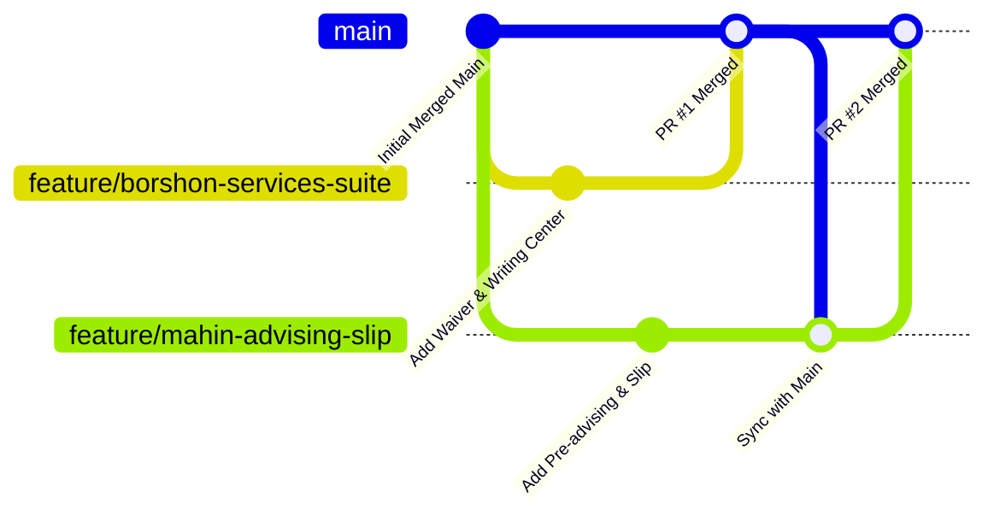

# NSU RDS Automation — QA Team Collaboration Guide
> **Contributors**: Mahin (@mahunn) & Borshon (@Borshan2004)  
> **Repository**: [mahunn/RDS-Playwrite-Test](https://github.com/mahunn/RDS-Playwrite-Test)

---

## 1. Architecture & Coding Conventions

- **Base Fixtures**: Always import `test` and `expect` from `src/fixtures/base.ts`. Never import directly from `@playwright/test`.
- **Page Objects**:
  - Extend [`BasePage`](file:///e:/RDS-Playwrite-Test/src/pages/BasePage.ts).
  - Use [`RdsStudentLandingPage`](file:///e:/RDS-Playwrite-Test/src/pages/RdsStudentLandingPage.ts) for landing navigation.
  - Never place `expect()` assertions inside Page Objects. Page Objects encapsulate element locators and user actions; assertions belong exclusively in test specs.
- **Locator Priority (Strict Hierarchy)**:
  1. `getByRole` with accessible name (e.g., `page.getByRole('button', { name: 'Submit' })`)
  2. `getByLabel` for form fields
  3. `getByPlaceholder`
  4. `getByTestId`
  5. `getByText` (for genuinely static UI text)
  6. CSS / XPath selectors (only when accessible locators cannot match legacy HTML/Bootstrap classes).
- **Assertions**: Web-first assertions only (`await expect(locator).toBeVisible()`). Zero arbitrary `waitForTimeout()` sleeps or `waitForSelector()`.

---

## 2. Credential & Session Safety (Root Cause & Resolution)

The NSU RDS portal enforces a **single active session per user account**. When a student logs in:
1. Any previous session cookie for that student ID is invalidated by the server.
2. During test runs, tests using the same student ID concurrently will destroy each other's cookies and bounce to the login page (`/rds/`).

### How It Is Resolved:
1. **Dynamic Auth State Synchronization**: In login tests, fresh session cookies are saved to the auth cache.
2. **Session Self-Healing**: [`RdsStudentLandingPage.goto()`](file:///e:/RDS-Playwrite-Test/src/pages/RdsStudentLandingPage.ts) detects expired sessions and re-authenticates automatically.
3. **Dedicated Test Accounts Per Module**:
   Always assign separate student IDs in [`tests/data/rds-student-data.json`](file:///e:/RDS-Playwrite-Test/tests/data/rds-student-data.json) and [`tests/data/test-users.json`](file:///e:/RDS-Playwrite-Test/tests/data/test-users.json):

| Student ID | Owner / Module | Auth Storage State |
|---|---|---|
| `2512560` | Borshon — Car Parking, Credit Status, Forgot ID, Waiver Course, Writing Center, Application Status | `playwright/.auth/student.json` |
| `2231451` | Borshon — Course Exclusion (Senior Student) | `playwright/.auth/senior-student.json` |
| `2421226` | Borshon — Course Inclusion, Leave, Semester Drop | `playwright/.auth/inclusion-student.json` |
| `2425471` | Borshon — ID Unlock | `playwright/.auth/unlock-student.json` |
| `2421354` | Mahin — Profile, Change Password, Major, Advising Window, Advising Slip, Pre-Advising | `playwright/.auth/profile-student.json` |
| `2512570` | Shared — 2FA Smoke Testing | Dynamic |

> [!IMPORTANT]
> **Never use an account assigned to another tester or to cached session storage for raw login testing.**

---

## 3. Git Feature-Branch & Pull Request Workflow

Never push unreviewed code directly to `main`. Use clean feature branches:



### Step-by-Step Git Commands:

1. **Pull latest `main` before starting work**:
   ```bash
   git checkout main
   git pull origin main
   ```

2. **Create your feature branch**:
   ```bash
   # Borshon
   git checkout -b feature/borshon-<feature-name>

   # Mahin
   git checkout -b feature/mahin-<feature-name>
   ```

3. **Implement Page Objects in `src/pages/` and specs in `tests/student/` or `tests/faculty/`**:
   - Store all student page objects in [`src/pages/`](file:///e:/RDS-Playwrite-Test/src/pages/).
   - Add navigation methods directly to [`RdsStudentLandingPage`](file:///e:/RDS-Playwrite-Test/src/pages/RdsStudentLandingPage.ts).

4. **Verify tests pass locally before committing**:
   ```bash
   npx playwright test tests/student/service/waiver-course.spec.ts
   ```

5. **Commit using Conventional Commits**:
   ```bash
   git add src/pages/RdsWaiverCoursePage.ts tests/student/service/waiver-course.spec.ts
   git commit -m "feat(student): add waiver course page object and spec"
   ```

6. **Push to origin and open a PR**:
   ```bash
   git push -u origin feature/<branch-name>
   ```

7. **Review & Merge on GitHub**:
   - Verify all checks pass.
   - Teammate approves and merges the Pull Request into `main`.

---

## 4. Running Tests Locally

Use targeted npm scripts to run specific modules quickly:

```bash
# Student Profile & Advising (Mahin)
npm run test:advising       # Advising Window & Course Slip
npm run test:slip           # Advising Print Slip (4-part layout, fees, clearances)
npm run test:preadvising    # Pre-Advising (Academic Probation Quiz & Courses)
npm run test:pre-courses    # Pre Advised Courses Slip & Schedule Details
npm run test:profile        # Student Information (General & Personal)
npm run test:password       # Change Password & OTP Modal
npm run test:major          # Major Declaration Prerequisite

# Student Services (Borshon)
npm run test:parking        # Car Parking Service
npm run test:exclusion      # Course Exclusion (Senior Student)
npm run test:inclusion      # Course Inclusion Request
npm run test:credit-status  # Credit / Non-Credit Status Update
npm run test:forgot-id      # Forgot RFID Application
npm run test:unlock-id      # ID Unlock Request
npm run test:leave          # Application for Leave
npm run test:drop           # Semester Drop Application

# Faculty Modules
npm run test:faculty        # Faculty Exam Marks Batch Entry

# Headed Run (Watch in Chrome)
npm run test:advising:headed

# Run Entire Suite
npx playwright test
```

---

## 5. Agentic Workflow (Working with Antigravity AI)

Whenever you want to build a new feature or test, simply prompt Antigravity:

> *"Create a branch for [Feature Name] and write the tests for it."*

The agent will automatically:
1. Switch to `main` and pull latest changes (`git pull`).
2. Create your isolated feature branch (`git checkout -b feature/...`).
3. Build the Page Object and spec file following strict locator hierarchy.
4. Execute and verify the test passes on the live RDS server.
5. Commit and push the branch to GitHub.
6. Provide you with the 1-click link to open your Pull Request!
