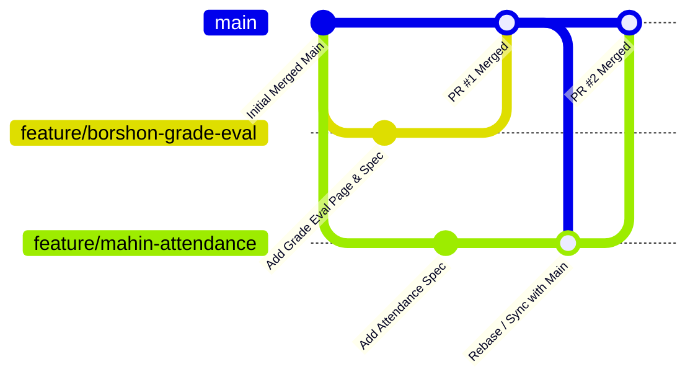

# NSU RDS Automation — QA Team Collaboration Guide
> **Contributors**: Mahin (@mahunn) & Borshon (@Borshan2004)  
> **Repository**: [mahunn/RDS-Playwrite-Test](https://github.com/mahunn/RDS-Playwrite-Test)

---

## 1. What Caused the Post-Merge Errors & How They Were Fixed

### The Root Cause: RDS Session Invalidation
The NSU RDS portal enforces a **single active session per user account**. When a student logs in:
1. Any previous session cookie for that student ID is invalidated by the server.
2. During the full test suite run (`npx playwright test`), `tests/auth.setup.ts` initially cached a session for student `2512560` in `playwright/.auth/student.json`.
3. Then `tests/auth/rds-student-login.spec.ts` ran in the `chromium` project and logged into `2512560` again, which destroyed the session saved in `student.json`.
4. Downstream tests (`car-parking.spec.ts`, `credit-status-update.spec.ts`, `forgot-id.spec.ts`) that read `student.json` were redirected back to the login page (`http://10.102.11.254/rds/`) and failed with URL expectation mismatches.

### How It Was Resolved
1. **Dynamic Auth State Synchronization**: `tests/auth/rds-student-login.spec.ts` now automatically syncs its refreshed session back to `playwright/.auth/student.json` upon login:
   ```typescript
   await page.context().storageState({ path: 'playwright/.auth/student.json' });
   ```
2. **Session Self-Healing**: [`RdsStudentLandingPage.goto()`](file:///e:/RDS-Playwrite-Test/src/pages/RdsStudentLandingPage.ts) detects if the browser was kicked back to the login page (`/rds/` or `/login`) and automatically re-authenticates on the fly, eliminating flaky tests caused by session loss.
3. **Unified Page Object Model**: [`LandingPage`](file:///e:/RDS-Playwrite-Test/src/pages/LandingPage.ts) now extends [`RdsStudentLandingPage`](file:///e:/RDS-Playwrite-Test/src/pages/RdsStudentLandingPage.ts), giving both testers immediate access to Profile, Advising, and all 8 Services methods under either class.
4. **All 24 Tests Passing**: The entire test suite across Authentication, Faculty Exam Marks, Profile, Advising, Change Password, Major Declaration, Car Parking, Course Exclusion, Course Inclusion, Credit Status, Forgot RFID, ID Unlock, Leave, and Semester Drop passes cleanly.

---

## 2. Team Workflow Blueprint

To work together smoothly without stepping on each other's code or invalidating each other's active sessions, follow these 4 golden rules:

### Rule 1: Dedicated Test Accounts Per Feature / Tester
Because RDS permits only **one concurrent login per ID**, always assign separate student IDs in [`tests/data/rds-student-data.json`](file:///e:/RDS-Playwrite-Test/tests/data/rds-student-data.json) and [`tests/data/test-users.json`](file:///e:/RDS-Playwrite-Test/tests/data/test-users.json):

| Student ID | Owner / Module | Auth Storage State |
|---|---|---|
| `2512560` | Borshon — Car Parking, Credit Status, Forgot ID | `playwright/.auth/student.json` |
| `2231451` | Borshon — Course Exclusion | `playwright/.auth/senior-student.json` |
| `2421226` | Borshon — Course Inclusion, Leave, Semester Drop | `playwright/.auth/inclusion-student.json` |
| `2425471` | Borshon — ID Unlock | `playwright/.auth/unlock-student.json` |
| `2421354` | Mahin — Profile, Change Password, Major, Advising | `playwright/.auth/profile-student.json` |
| `2512570` | Shared — 2FA Smoke Testing | Dynamic |

> [!IMPORTANT]
> **Never use an account assigned to another tester or to cached session storage for raw login testing.**

---

### Rule 2: Git Feature-Branch & Pull Request Workflow
Never push directly to `main`. Use clean feature branches:



#### Step-by-Step Git Commands:
1. **Pull the latest `main` before starting work**:
   ```bash
   git checkout main
   git pull origin main
   ```
2. **Create your feature branch**:
   ```bash
   git checkout -b feature/your-feature-name
   # e.g., git checkout -b feature/borshon-degree-application
   # e.g., git checkout -b feature/mahin-course-drop
   ```
3. **Commit your changes using Conventional Commits**:
   ```bash
   git add src/pages/NewPage.ts tests/student/new-feature.spec.ts
   git commit -m "feat(student): add degree application page object and spec"
   ```
4. **Push your branch to GitHub**:
   ```bash
   git push -u origin feature/your-feature-name
   ```
5. **Open a Pull Request (PR) on GitHub**:
   - The other teammate reviews the PR.
   - Verify that all tests pass locally before approving and merging.

---

### Rule 3: Single Source of Truth for Page Objects
- Store all student page objects in [`src/pages/`](file:///e:/RDS-Playwrite-Test/src/pages/).
- Always extend [`BasePage`](file:///e:/RDS-Playwrite-Test/src/pages/BasePage.ts).
- Add navigation methods directly to [`RdsStudentLandingPage`](file:///e:/RDS-Playwrite-Test/src/pages/RdsStudentLandingPage.ts).
- Never put `expect()` assertions inside Page Object files.

---

### Rule 4: Running Tests Locally
Use the targeted npm scripts to run your specific test without running the entire suite:

```bash
# Run specific module
npm run test:profile        # Mahin: Profile tests
npm run test:password       # Mahin: Change password
npm run test:major          # Mahin: Major declaration
npm run test:advising       # Mahin: Advising window
npm run test:parking        # Borshon: Car parking
npm run test:exclusion      # Borshon: Course exclusion
npm run test:inclusion      # Borshon: Course inclusion
npm run test:credit-status  # Borshon: Credit/Non-Credit update
npm run test:forgot-id      # Borshon: Forgot RFID
npm run test:unlock-id      # Borshon: ID unlock
npm run test:leave          # Borshon: Application for leave
npm run test:drop           # Borshon: Semester drop
npm run test:faculty        # Faculty: Exam marks entry

# Run with visible browser
npx playwright test tests/student/car-parking.spec.ts --headed

# Run entire test suite before opening a PR
npx playwright test
```

---

## 3. Agentic Workflow (Working with Antigravity AI)

Whenever you want to build a new feature or test, simply prompt Antigravity:

> *"Create a branch for [Feature Name] and write the tests for it."*

The agent will automatically:
1. Switch to `main` and pull latest changes (`git pull`).
2. Create your isolated feature branch (`git checkout -b feature/...`).
3. Build the Page Object and spec file following strict locator hierarchy.
4. Execute and verify the test passes on the live RDS server.
5. Commit and push the branch to GitHub.
6. Provide you with the 1-click link to open your Pull Request!


